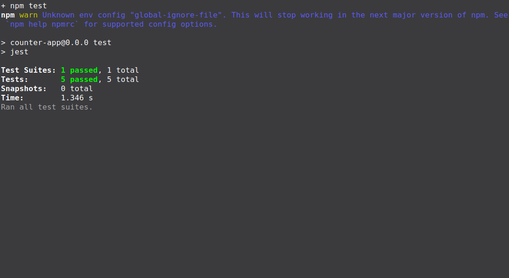
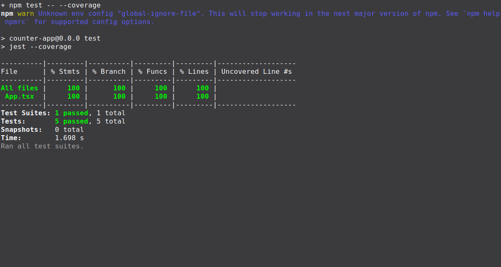

# Lab: Exploratory and White Box Testing

## Topics

- Exploratory testing
- White box testing
- Statement coverage
- Code coverage
- React component testing

## Learning Objectives

- Perform a focused exploratory testing session.
- Examine source code to identify statements, branches, and loops.
- Design white box tests based on the internal structure of an application.
- Test React state changes and user interactions.
- Use a coverage report to evaluate test coverage.
- Compare tests created before and after viewing the source code.

# Deliverables

## Step 1: Exploratory Testing

Run the counter application without looking at the source code.

Write a short testing charter that describes what you plan to investigate.

Testing charter: Explore how Increment, Decrement, and Reset change the displayed count, including repeated actions and using the buttons after resetting.

Record at least **five actions or combinations of actions** you tried. For each one, include:

- What you did
- What you expected
- What happened
- Whether the test passed or failed


### Example exploratory testing table

| Action                | Expected Result            | Actual Result | Pass or Fail |
| --------------------- | -------------------------- | ------------- | ------------ |
| Select Increment once from `0`. | The count becomes `1`. | Displayed `Count: 1`. | Pass |
| Select Decrement once from `0`. | The count becomes `-1`. | Displayed `Count: -1`. | Pass |
| Select Reset from `-1`. | The count returns to `0`. | Displayed `Count: 0`. | Pass |
| From `0`, select Increment twice, then Decrement once. | The count changes to `1`, then `2`, then `1`. | Displayed `Count: 1`, then `Count: 2`, then `Count: 1`. | Pass |
| From `1`, select Reset, then Increment once. | The count returns to `0`, then becomes `1`. | Displayed `Count: 0`, then `Count: 1`. | Pass |


Files involved: `Readmd.md` (charter and results) and `counter-app/` (running application). All five interface checks passed without inspecting the application source.

## Step 2: Examine the Source Code

After completing your exploratory testing, examine the source code in `App.tsx`.

Identify:

- The starting value of `count`
- The statements that change `count`
- The user action that causes each statement to execute
- Any branches or loops in the code

Explain whether branch coverage and loop coverage apply to this component.

### Responses

The starting value of `count` is `0`, set by `useState(0)`. The heading displays the current value.

| Statement | User Action | Effect |
| --------- | ----------- | ------ |
| `setCount(count + 1)` | Select Increment. | Increases the count by one. |
| `setCount(count - 1)` | Select Decrement. | Decreases the count by one. |
| `setCount(0)` | Select Reset. | Sets the count to zero. |

There are no conditional branches or loops in `App.tsx`, so there are no branch outcomes or loop iterations to test. The three button handlers are separate functions, not branches. Statement coverage applies because each count-changing statement needs to execute.

Files involved: `counter-app/src/App.tsx` (reviewed, unchanged) and `Readmd.md` (findings).

## Step 3: Create the Test File

Create the following test file:

```text
src/App.test.tsx
```

Use React Testing Library to render the component and interact with its buttons.

Your tests should use:

- `render` to render the component
- `screen` to find elements
- `fireEvent` or `userEvent` to select buttons
- Jest assertions to verify the displayed count

Organize your tests inside a `describe` block.

### Responses

Created `counter-app/src/App.test.tsx` with a `describe("App", ...)` group. Installed Jest, ts-jest, Jest types, the jsdom test environment, and React Testing Library with its DOM dependency.

| File | Work Performed |
| ---- | -------------- |
| `counter-app/src/App.test.tsx` | Created the test-file structure. |
| `counter-app/jest.config.cjs` | Configured jsdom, TypeScript/TSX transformation, and coverage collection for `App.tsx`. |
| `counter-app/tsconfig.test.json` | Configured TypeScript and JSX support for the tests. |
| `counter-app/package.json` | Added the testing dependencies and the `npm test` script. |
| `counter-app/package-lock.json` | Recorded the installed dependencies. |
| `counter-app/tsconfig.app.json` | Added Jest types so the test globals are recognized. |

Verification: `npm test -- --listTests --runInBand` discovered `src/App.test.tsx`, and the TypeScript check passed. This verified the setup, not test behavior. The application source remained unchanged.

## Step 4: Test the Starting State

Write a test that verifies the component's initial state.

Confirm that:

- The component displays `Count: 0`
- The Increment button appears
- The Decrement button appears
- The Reset button appears

### Responses

Added one starting-state test in `counter-app/src/App.test.tsx`. It renders `App`, verifies the heading displays `Count: 0`, and checks that the Increment, Decrement, and Reset buttons appear without clicking them.

Ran `npm test -- --runInBand` from `counter-app/`: one test passed in one test file. The component in `counter-app/src/App.tsx` remained unchanged.

## Step 5: Test Statement Coverage

Write tests that execute each statement that changes the count.

Include tests that verify:

- Increment changes the count from `0` to `1`
- Decrement changes the count from `0` to `-1`
- Reset changes the count back to `0`

The Reset test must first change the count to a value other than `0`.

### Responses

Added three tests in `counter-app/src/App.test.tsx`, using `fireEvent.click` to select the buttons and assertions to check the displayed count.

| Test | Verified Result | Result |
| ---- | --------------- | ------ |
| Increment | Changes the count from `0` to `1`. | Passed |
| Decrement | Changes the count from `0` to `-1`. | Passed |
| Reset | Changes the count to `1`, verifies it, then resets it to `0`. | Passed |

Ran `npm test -- --runInBand --verbose` from `counter-app/`: all four tests passed in one test file, including the starting-state test. The button clicks executed each count-changing statement in `counter-app/src/App.tsx`; that source file remained unchanged.

## Step 6: Test a Sequence of Actions

Write at least **one additional test** that performs multiple actions in sequence.

For example, you could:

- Increment several times
- Decrement after incrementing
- Reset after several changes
- Continue using the buttons after resetting

Check the displayed count after each important action.

### Responses

Added one sequence test in `counter-app/src/App.test.tsx`. It renders `App` once, selects Increment twice, Decrement, Reset, and Increment again, and verifies the displayed counts `1 → 2 → 1 → 0 → 1` after the clicks. This checks repeated changes and continued use after resetting.

Ran `npm test -- --runInBand --verbose` from `counter-app/`: all five tests passed in one test file. The component in `counter-app/src/App.tsx` remained unchanged.

## Step 7: Run the Tests

Run your test suite:

```bash
npm test
```



Include a screenshot showing the completed test run.

### Responses

Ran `npm test` from `counter-app/`: all five tests passed in one test file, with exit code `0`. Saved and inspected the terminal screenshot at `screenshots/step7-test-results.png`. The test file `counter-app/src/App.test.tsx` and component `counter-app/src/App.tsx` remained unchanged.

## Step 8: Review Code Coverage

Run Jest with code coverage enabled:

```bash
npm test -- --coverage
```



Record the coverage percentages reported for `App.tsx`:

| Coverage Type | Percentage |
| ------------- | ---------- |
| Statements    | 100%       |
| Branches      | 100%       |
| Functions     | 100%       |
| Lines         | 100%       |

Include a screenshot of the coverage report.

Briefly explain:

- Which parts of the component your tests executed
- Whether any statements remained untested
- Why the component may report few or no branches
- Whether you believe the percentage alone proves that the component works correctly

### Responses

Ran `npm test -- --coverage` from `counter-app/`: all five tests passed in one test file, with exit code `0`. Jest created the reports in `counter-app/coverage/`. Saved and inspected `screenshots/step8-coverage.png`; the tests in `counter-app/src/App.test.tsx` and component in `counter-app/src/App.tsx` remained unchanged.

- Executed the component's state setup and rendering, plus all three button handlers for Increment, Decrement, and Reset.
- No measured statements remained untested. The report recorded all seven statements and all four functions as covered.
- The report recorded zero branches because the component has no conditional decisions. Jest reports 100% branch coverage because there are no branch outcomes left uncovered.
- The percentage alone does not prove correctness. It shows which code ran, but meaningful assertions are still needed to check results, and these tests cannot prove every possible interaction works.

## Step 9: Compare the Two Approaches

Write a short comparison of your exploratory and white box testing.

Include:

- One test idea you discovered through exploratory testing
- One test idea you discovered by reading the source code
- How viewing the code changed your testing
- One limitation of each approach

### Responses

- Exploratory testing suggested trying Increment after Reset to check whether the counter still worked.
- Reading the three button handlers suggested a separate test for each `setCount` statement, including verifying a nonzero count before Reset.
- Viewing the code changed the focus from trying button combinations to writing repeatable tests that execute each statement and check the displayed result.
- Exploratory testing can miss code that the chosen actions never reach. White box testing can reach every statement but still miss incorrect behavior if the assertions or scenarios are incomplete.

Files involved: `Readmd.md` (exploratory observations and comparison), `counter-app/src/App.tsx` (reviewed source), `counter-app/src/App.test.tsx` (automated tests), and `counter-app/coverage/` (coverage results). Source and tests remained unchanged during this comparison.

Final verification: `npm test` passed all five tests in one test file. Both screenshot links and the generated coverage data were checked.

## What to Submit

1. Create and initialize a GitHub repository.
2. Commit and push your work to the repository.
3. Make sure the repository is public. Private repositories will not receive credit.

## AI Transparency

AI was used to help create portions of this file and to clean up its writing and formatting.
